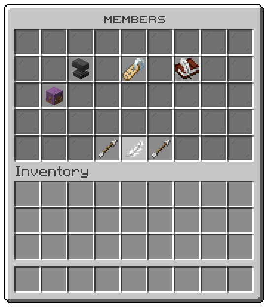

## Members

The file is `menus/island-members.conf`. The window is titled "Members" and has 5 rows.
The team of the island, the window the members tile of the island menu opens.

| Slot | Item | What it shows | Click |
|---|---|---|---|
| 11 | `ANVIL` | Invite a player: Asks another player to join your island. They have five minutes to answer. | asks you to type, runs `/is invite %input%` |
| 13 | `NAME_TAG` | The team: Everyone who belongs to your island, and the role each one holds. | runs `/is members list` |
| 15 | `WRITABLE_BOOK` | Roles: What each role on your island may do. | opens the [roles window](#roles) |
| 19-25, 28-34 | `head:%entry_uuid%` | One tile for each entry. Someone who belongs to your island. | opens that member's role |
| 39 | `ARROW` | ← Previous page |  |
| 39 | `ARROW` | ← No page before this one |  |
| 41 | `ARROW` | → Next page |  |
| 41 | `ARROW` | → No page after this one |  |
| 40 | `FEATHER` | « Back | opens the [island menu window](island.md#island-menu) |

## Member role

The file is `menus/island-member-role.conf`. The window is titled "Role of" and has 3 rows.
The role one member holds, the window a member on the members window opens.

| Slot | Item | What it shows | Click |
|---|---|---|---|
| 10-16 | `%entry_material%` | One tile for each entry. A role you can give this member. | gives that role |
| 21 | `ARROW` | ← Previous page |  |
| 21 | `ARROW` | ← No page before this one |  |
| 22 | `FEATHER` | « Back | opens the [members window](#members) |
| 23 | `ARROW` | → Next page |  |
| 23 | `ARROW` | → No page after this one |  |

## Roles

The file is `menus/island-roles.conf`. The window is titled "Roles" and has 4 rows.
The roles of the island, the window the roles tile of the members window opens.

| Slot | Item | What it shows | Click |
|---|---|---|---|
| 4 | `WRITABLE_BOOK` | New role: A role of your own, beside the four every island has. It starts with what members may do. | asks you to type, runs `/is permissions create %input%`, opens the [roles window](#roles) |
| 10-16, 19-25 | `%entry_material%` | One tile for each entry. One of the roles on your island. | opens what that role may do |
| 30 | `ARROW` | ← Previous page |  |
| 30 | `ARROW` | ← No page before this one |  |
| 31 | `FEATHER` | « Back | opens the [members window](#members) |
| 32 | `ARROW` | → Next page |  |
| 32 | `ARROW` | → No page after this one |  |

## Role permissions

The file is `menus/island-role-permissions.conf`. The window is titled "" and has 5 rows.
What one role of the island may do, the window a role on the roles window opens.

| Slot | Item | What it shows | Click |
|---|---|---|---|
| 0-35 | `%entry_material%` | One tile for each entry. Something a member of this role does on your island. | turns that permission on or off |
| 39 | `ARROW` | ← Previous page |  |
| 39 | `ARROW` | ← No page before this one |  |
| 40 | `FEATHER` | « Back | opens the [roles window](#roles) |
| 41 | `ARROW` | → Next page |  |
| 41 | `ARROW` | → No page after this one |  |
| 44 | `LAVA_BUCKET` | Take this role away: Whoever holds it becomes a member again. | Shift left: removes the role; Shift right: removes the role |
